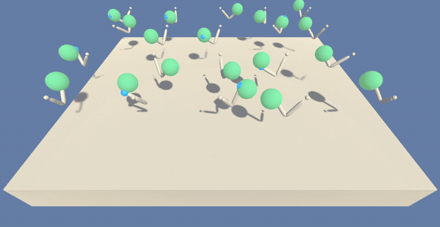

# Continuous Control (Reacher, 20 arms)

A DDPG agent that teaches 20 double-jointed robot arms to keep their hands inside moving target zones.
It solves the 20-agent version of the environment at **episode 174** (average score 30.23 over episodes 75–174).
See [Report.md](Report.md) for the algorithm, hyperparameters and results.



*The trained agent, at 8× speed. A target turns green while the arm's hand is inside it.*

## Project details

**Environment:** Unity ML-Agents [Reacher](https://github.com/Unity-Technologies/ml-agents/blob/master/docs/Learning-Environment-Examples.md#reacher), version 2 (20 identical arms, each with its own copy of the environment).

| | |
| --- | --- |
| **State space** | 33 continuous values per arm: position, rotation, velocity and angular velocity of the arm |
| **Action space** | 4 continuous values per arm: torques for the two joints, each in [-1, 1] |
| **Reward** | +0.1 for every step the arm's hand is inside the target zone |
| **Episode length** | About 1000 steps |

**When it is solved:**
1. After each episode, add up each arm's rewards (no discounting). This gives 20 scores.
2. Average those 20 scores to get the episode's score.
3. The environment is solved when the average of these episode scores over **100 consecutive episodes** is at least **+30**.

## Getting started

These steps were tested on Linux (WSL2) with Python 3.10.

1. **Create a Python environment** and install the packages:
   ```bash
   conda create -n drlnd python=3.10
   conda activate drlnd
   pip install torch numpy matplotlib
   ```

2. **Install `unityagents`** directly from the `python/` folder of the [Udacity DRLND repository](https://github.com/udacity/deep-reinforcement-learning).
   Its pinned requirements (TensorFlow 1.7, PyTorch 0.4) don't install on Python 3.10, so install it without them and add its runtime dependencies by hand:
   ```bash
   pip install --no-deps "git+https://github.com/udacity/deep-reinforcement-learning.git#subdirectory=python"
   pip install "protobuf==3.20.3" grpcio docopt pyyaml pillow
   ```

3. **Download the 20-arm environment** for your operating system and unzip it in this folder:
   - Linux: [click here](https://s3-us-west-1.amazonaws.com/udacity-drlnd/P2/Reacher/Reacher_Linux.zip)
   - Linux, headless (no screen, e.g. AWS): [click here](https://s3-us-west-1.amazonaws.com/udacity-drlnd/P2/Reacher/Reacher_Linux_NoVis.zip)
   - Mac OSX: [click here](https://s3-us-west-1.amazonaws.com/udacity-drlnd/P2/Reacher/Reacher.app.zip)
   - Windows (32-bit): [click here](https://s3-us-west-1.amazonaws.com/udacity-drlnd/P2/Reacher/Reacher_Windows_x86.zip)
   - Windows (64-bit): [click here](https://s3-us-west-1.amazonaws.com/udacity-drlnd/P2/Reacher/Reacher_Windows_x86_64.zip)

   The scripts expect `Reacher_Linux_20/Reacher.x86_64`. For another location or OS, pass the path with `--env`.

## Instructions

Run all commands from this folder.

**Train the agent:**
```bash
python train.py
```
- Progress is printed and written to `train.log`. A score plot is saved to `scores.png`.
- Training resumes from `checkpoint_multi.pth` if it exists. Press Ctrl+C to stop; it saves first.
- When solved, the trained weights are saved to `checkpoint_actor_multi.pth` and `checkpoint_critic_multi.pth`.

**Test the trained agent** (no exploration noise):
```bash
python test.py --graphics --episodes 1   # watch the trained arms
python test.py --episodes 100            # measure the average score
```

Run `python train.py --help` or `python test.py --help` for all options. [TRAINING.md](TRAINING.md) has a full guide.

## Files

| File | Purpose |
| --- | --- |
| `train.py` | Trains the agent from the command line |
| `test.py` | Runs the trained agent without exploration noise |
| `ddpg_multi_agent.py` | DDPG agent shared by all 20 arms, OU noise and replay buffer |
| `model.py` | Actor and critic neural networks |
| `checkpoint_actor_multi.pth` | Trained actor weights |
| `checkpoint_critic_multi.pth` | Trained critic weights |
| `scores.png` | Score per episode from the solving run |
| `images/trained_agent.gif` | The trained agent, 2-minute run sped up 8× |
| `Report.md` | Project report |
| `TRAINING.md` | Detailed guide to the training and testing commands |