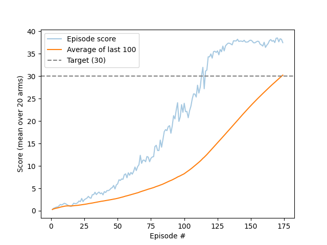

# Report: Continuous Control with DDPG

The agent solves the 20-arm Reacher environment at **episode 174**: the average score over episodes 75–174 is **30.23** (target: 30).
Training took about 32 minutes. Run without exploration noise, the trained agent scores **38.94** on average (3 test episodes).

## Learning algorithm

The agent uses **Deep Deterministic Policy Gradient (DDPG)** ([Lillicrap et al., 2015](https://arxiv.org/abs/1509.02971)), an actor-critic method for continuous actions.

- **Actor** μ(s): maps a state directly to an action (4 torques).
- **Critic** Q(s, a): estimates the expected return of taking action a in state s.
- **Critic update:** minimize the mean squared error between Q(s, a) and the target

  ```latex
  y = r + \gamma \, Q_{target}(s', \mu_{target}(s')) \, (1 - done)
  ```

- **Actor update:** maximize Q(s, μ(s)), i.e. move the actor towards actions the critic scores higher.
- **Target networks:** slow-moving copies of the actor and critic, used to compute y. After every update they move a small step towards the local networks: θ_target = τ·θ_local + (1 − τ)·θ_target.
- **Replay buffer:** experiences are stored and sampled at random, which breaks the correlation between consecutive steps.
- **Exploration:** Ornstein-Uhlenbeck (OU) noise is added to the actor's actions during training, then actions are clipped to [-1, 1].

### Adapting DDPG to 20 arms

All 20 arms share **one** actor, **one** critic and **one** replay buffer. Each step adds 20 experiences, so the buffer fills with varied data 20 times faster than with a single arm.

Changes from the single-agent DDPG code in the course:

| Change | Why |
| --- | --- |
| Learn **10 times every 20 steps** instead of once per step | Updating once per experience (20 per step) made training slow and less stable |
| **One OU noise process per arm** (shape 20 × 4) | With one shared process, every arm explored in exactly the same direction |
| OU noise uses **Gaussian** samples | The original code used uniform [0, 1) samples, which are always positive and push all actions the same way |
| **Critic gradient clipping** (max norm 1) | Limits the size of each critic update, a common fix for unstable DDPG on Reacher |
| Replay buffer stored as **fixed float32 arrays** | A deque of Python tuples used over 1.5 GB at 1e6 experiences and ran the machine out of memory; the arrays use about 275 MB |

### Hyperparameters

| Hyperparameter | Value | Meaning |
| --- | --- | --- |
| Replay buffer size | 1,000,000 | Experiences kept (about 50 episodes of 20 arms) |
| Batch size | 256 | Experiences per update |
| γ (gamma) | 0.99 | Discount factor |
| τ (tau) | 0.001 | Soft update rate for target networks |
| Actor learning rate | 1e-4 | Adam optimizer |
| Critic learning rate | 1e-3 | Adam optimizer |
| Weight decay | 0 | L2 penalty on the critic |
| Learn every | 20 steps | How often learning happens |
| Updates per learning step | 10 | Minibatch updates each time |
| Critic gradient clip | 1.0 | Max gradient norm |
| OU noise θ (theta) | 0.15 | Pull of the noise back towards 0 |
| OU noise σ (sigma) | 0.2 | Size of the random kicks |
| Max steps per episode | 1000 | Full Reacher episode |
| Random seed | 2 | |

### Model architectures

Both networks are fully connected. The final layer's weights start in [-3e-3, 3e-3], so initial outputs are close to zero.

**Actor** (state → action):

| Layer | Size | Activation |
| --- | --- | --- |
| Input | 33 (state) | |
| Hidden 1 | 400 | ReLU |
| Hidden 2 | 300 | ReLU |
| Output | 4 (action) | tanh, keeps actions in [-1, 1] |

**Critic** (state, action → Q-value):

| Layer | Size | Activation |
| --- | --- | --- |
| Input | 33 (state) | |
| Hidden 1 | 400 | ReLU |
| Hidden 2 | 400 + 4 (hidden 1 output joined with the action) → 300 | ReLU |
| Output | 1 (Q-value) | none |

The action joins the critic at the second layer, as in the DDPG paper.

## Plot of rewards



- **Light blue:** score of each episode (average over the 20 arms).
- **Orange:** average of the last 100 episodes.
- **Dashed line:** target of 30.

| Episode | Episode score | Average of last 100 |
| --- | --- | --- |
| 50 | 6.00 | 2.78 |
| 100 | 23.96 | 8.26 |
| 150 | 38.02 | 23.44 |
| **174** | 37.46 | **30.23** |

The episode score first passed 30 at episode 113, stayed above 30 from episode 116, and stayed between 34.8 and 38.5 from episode 125 on.
**The environment was solved at episode 174**, when the average over episodes 75–174 reached 30.23.

## What I learned during tuning

- An earlier run with **σ = 0.1** reached only about 6.6 (100-episode average) after 447 episodes. The solving run used **σ = 0.2** and the fixed replay buffer from the start. The two runs differ in more than σ (the earlier one was also stopped and resumed), so this is an observation, not a controlled comparison.
- Running Unity **without graphics** cut the environment step time from about 10.5 ms to 6.7 ms. Episodes in the solving run took about 11–12 seconds.

## Ideas for future work

1. **TD3** ([Fujimoto et al., 2018](https://arxiv.org/abs/1802.09477)): twin critics, delayed actor updates and target-action smoothing. These reduce DDPG's overestimation of Q-values and usually make training more stable.
2. **D4PG** ([Barth-Maron et al., 2018](https://openreview.net/pdf?id=SyZipzbCb)): a distributional critic and N-step returns. It is designed for many parallel agents like these 20 arms.
3. **PPO** ([Schulman et al., 2017](https://arxiv.org/abs/1707.06347)): an on-policy method. The 20 arms supply enough fresh data each step to make it practical, and it is often less sensitive to hyperparameters.
4. **Prioritized experience replay** ([Schaul et al., 2015](https://arxiv.org/abs/1511.05952)): sample experiences with large critic errors more often, to learn faster from surprising transitions.
5. **Noise decay:** reduce σ gradually during training, to explore early and act more precisely later.
6. **Controlled hyperparameter search:** compare σ, learning rates and the learn-every / updates-per-step schedule with several seeds each, to find out which settings matter most.
